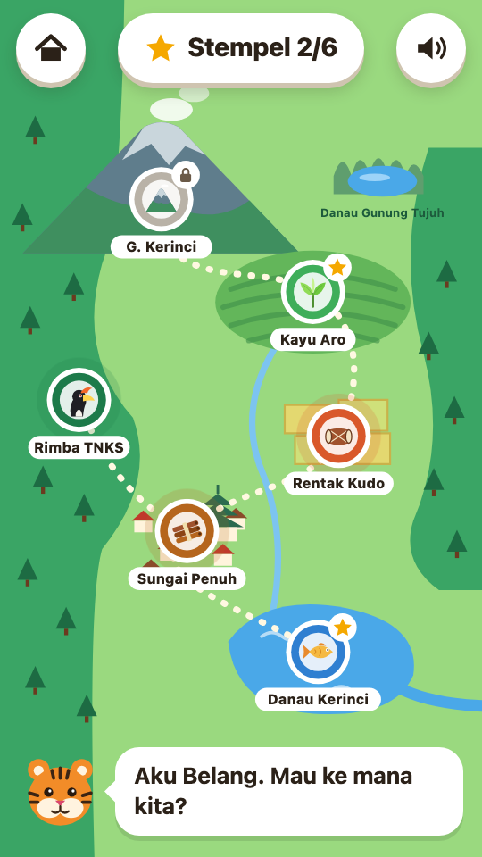

# Jelajah Kerinci

A browser game for children in the first years of primary school in Kerinci, Sumatra.
They explore a map of Kerinci, play a short mini-game at each place, and collect stamps.
Every stamp opens one short fact and one word in the Kerinci language.

**[Play it at kerinciku.web.id →](https://kerinciku.web.id)**

[](https://github.com/XNyetok/Kerinciku/actions/workflows/ci.yml)
[](LICENSE)

| Map | A game |
| --- | --- |
|  |  |

The game is in Indonesian, with words in the Kerinci language. It is designed for Android
phones held upright, and also runs on a laptop. The game itself is about 150 KB, its
sounds about 1.2 MB more, and after one visit it plays without a connection.

## What is in it

| Place on the map | Mini-game | How it plays |
| --- | --- | --- |
| Kayu Aro | Petik Teh (tea picking) | Tap the tea shoots that pop up, leave the caterpillars alone (40 seconds). |
| Rimba TNKS | Potret Satwa (wildlife photos) | Tap the animals peeking out of the bushes until all five are photographed. |
| Rentak Kudo | Ikuti Irama (rhythm) | Watch and hear a pattern of instruments, then repeat it (4 rounds). |
| Sungai Penuh | Cari Pasangan (memory cards) | Find the six pairs of Kerinci's produce. |
| Danau Kerinci | Tangkap Ikan (fishing) | Slide the boat to catch fish, steer clear of the water hyacinth (40 seconds). |
| Gunung Kerinci | Mendaki Gunung (the climb) | Not open yet: the summit stays locked on the map while more places are added. |

No game can be lost. Each one always gives a stamp with one to three stars, and a child
may replay it for more stars.

## Running it locally

Nothing needs building. The simplest way is to open `index.html` in a browser.

To run it the way the live site does, with the same security policy, use the small server
that comes with the project (Node 22 or newer):

```sh
npm install
npm run serve        # http://127.0.0.1:8765
```

## Checking a change

```sh
npm run check        # files, places on the map and the security policy agree
npm test             # the game clock, saved progress, the build, the collector, the deploy script, the privacy check
npm run test:e2e     # plays all six games in a browser (phone and desktop)
npm run build        # copies the site into dist/ and checks its size
```

The browser tests need Chromium once: `npx playwright install chromium`.

## Text and the Kerinci language

Everything a player reads is in `js/strings.js`, in Indonesian, and nowhere else. The
words in the Kerinci language have been confirmed by a native speaker:

| Word | Meaning used | Where |
| --- | --- | --- |
| Apo kabar, uhang Kincai? | How are you, people of Kerinci? | Title screen |
| aro | a fig tree, a kind of banyan | Kayu Aro |
| imbo | forest | Rimba TNKS |
| kulit manaih | cinnamon | Sungai Penuh |
| aye | water | Danau Kerinci |

Dialects differ from village to village. Corrections from native speakers are very
welcome: open an issue, or send a pull request that changes `js/strings.js`. A word that
nobody has confirmed yet is marked `// CHECK` there.

The fact shown at each place (`fact`) and the heights of the posts on the climb
(`mountain.posts`) are in the same file. Every height but the summit's is approximate.

## Layout

```
index.html              the single page
css/style.css           all styling
js/strings.js           all interface text, the list of places, the Kerinci words
js/util.js              helpers, saved progress, the game clock
js/art.js               every picture (SVG), including the map
js/audio.js             effects, music and narration (Web Audio)
js/main.js              the screens: title, map, introduction, game, result, stamp book
js/game/*.js            one file per mini-game
js/boot.js              the reload prompt when a file fails to load
js/version.js           the version number, stamped by the build
js/telemetry.js         anonymous counts of visits and games (docs/telemetry.md)
sw.js                   offline play
manifest.webmanifest    what "Add to home screen" uses
icons/                  app icons
audio/                  recorded effects, music and narration (docs/audio.md)

server/                 the collector of those counts and its panel (Node, SQLite)
scripts/                build, local server, checks
tests/                  unit tests and browser tests
deploy/                 server script, nginx config, the collector's service
docs/deploy.md          how a release reaches the server
docs/telemetry.md       what is counted, what never is, and the panel
docs/audio.md           where the sounds come from and how to replace one
```

The game ships no libraries and no image files: pictures are drawn in SVG, which keeps
the part a game needs before it can be played small. The sounds in `audio/` are fetched
after the page has loaded, and the game plays without them: until a sound has arrived, the
browser synthesises a stand-in.

## Adding a mini-game

1. Add an entry to `JK.places` in `js/strings.js`: `id`, `icon`, `color`, the pin's `x`
   and `y` on the map (the map is 360 x 500), the titles, how to play, the fact and the
   Kerinci word. Add its result sentence to `JK.text.result`.
2. Create `js/game/<id>.js` that registers `JK.game.<id> = function (g) { ... }`. The
   object `g` has:
   - `g.stage`: the element the game draws into.
   - `g.clock`: the game clock. Use `g.clock.after(fn, ms)` for delays and
     `g.clock.each(fn)` for per-frame movement, not `setTimeout`, so the game stops when it
     is paused or left.
   - `g.score(value)` and `g.progress(0..1)`: update the number and the bar at the top.
   - `g.finish({ stars: 1..3, message: '...' })`: end the game and open the result screen.
3. Add the file's `<script>` to `index.html`.

`npm run check` says what is missing. The list of files to cache for offline play and the
version number are filled in by the build.

The live site allows no inline script or style (Content-Security-Policy): do not write
`style="..."` or `onclick="..."` into markup built in JavaScript. Use `el.style` and
`el.onclick`.

## Notes

- Stamps and the sound setting are kept on the player's own device (`localStorage`). The
  stamp book has a "start over" button.
- The game counts visits and games anonymously, to see which game needs work: no cookie,
  no identifier, no stored address, and nothing at all when the browser sends Do Not Track
  (`docs/telemetry.md`).
- Narration is recorded. When a clip cannot be loaded, the device's own voice reads the
  text instead, and only when the device has an Indonesian voice.
- When a file fails to load (a weak signal, for example), a message with a reload button
  appears instead of a frozen screen.
- The Incung script is not in the game yet: its letters have to come from a proper source,
  not be drawn from memory.

## Contributing

See [CONTRIBUTING.md](CONTRIBUTING.md). Report security problems through
[SECURITY.md](SECURITY.md), not in a public issue.

## License

[MIT](LICENSE).
