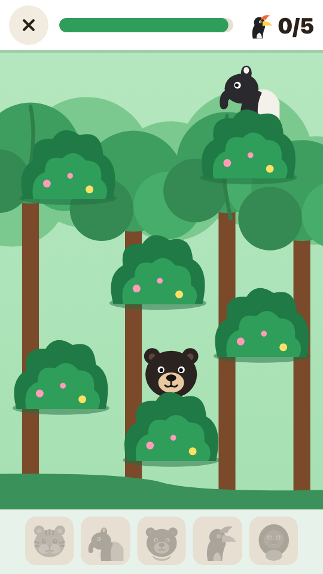

# Jelajah Kerinci

Permainan browser untuk anak SD kelas 1-3 di Kerinci. Anak menjelajahi peta Kerinci,
memainkan mini-game pendek di tiap tempat, dan mengumpulkan stempel. Setiap stempel
membuka satu fakta singkat dan satu kata bahasa Kerinci.

**[Mainkan di kerinciku.web.id →](https://kerinciku.web.id)**

[](https://github.com/XNyetok/Kerinciku/actions/workflows/ci.yml)
[](LICENSE)

| Peta | Permainan |
| --- | --- |
|  |  |

Dirancang untuk HP Android (layar sentuh, posisi tegak), tetapi juga berjalan di laptop.
Seluruh permainan berukuran sekitar 150 KB dan, setelah dibuka sekali, bisa dimainkan
tanpa internet.

## Isi permainan

| Tempat di peta | Mini-game | Cara main |
| --- | --- | --- |
| Kayu Aro | Petik Teh | Sentuh pucuk teh yang muncul, jangan sentuh ulat (40 detik). |
| Rimba TNKS | Potret Satwa | Sentuh satwa yang mengintip dari semak sampai lima satwa terpotret. |
| Rentak Kudo | Ikuti Irama | Lihat dan dengar urutan bunyi alat musik, lalu ulangi (4 babak). |
| Sungai Penuh | Cari Pasangan | Kartu memori hasil bumi Kerinci, 6 pasang. |
| Danau Kerinci | Tangkap Ikan | Geser perahu untuk menangkap ikan, hindari eceng gondok (40 detik). |
| Gunung Kerinci | Mendaki Gunung | Terbuka setelah 5 stempel lain terkumpul. Sentuh layar untuk melangkah sampai puncak. |

Tidak ada "kalah". Setiap game selalu memberi stempel dengan 1 sampai 3 bintang, dan anak
boleh mengulang untuk menambah bintang.

## Menjalankan di komputer

Tidak ada yang perlu di-build. Cara termudah adalah membuka `index.html` langsung di
browser.

Untuk menjalankannya seperti di situs aslinya, dengan aturan keamanan yang sama, pakai
server kecil bawaan proyek (perlu Node 22 atau lebih baru):

```sh
npm install
npm run serve        # http://127.0.0.1:8765
```

## Memeriksa perubahan

```sh
npm run check        # berkas, tempat di peta, dan aturan keamanan saling cocok
npm test             # jam permainan, build, skrip deploy, pemeriksa privasi
npm run test:e2e     # memainkan keenam game di browser (HP dan desktop)
npm run build        # menyalin situs ke dist/ dan memeriksa ukurannya
```

Uji browser memerlukan Chromium sekali saja: `npx playwright install chromium`.

## Mengubah teks dan kata bahasa Kerinci

Semua teks ada di `js/teks.js`. Kata bahasa Kerinci yang belum diperiksa penutur asli
diberi tanda `// PERIKSA`:

| Kata | Arti yang dipakai | Di mana |
| --- | --- | --- |
| Apo kabar, uhang Kincai? | Apa kabar, orang Kerinci? | Halaman depan |
| aro | pohon ara, sejenis beringin | Kayu Aro |
| imbo | hutan | Rimba TNKS |
| kulit manih | kayu manis | Sungai Penuh |
| ayik | air | Danau Kerinci |

Dialek tiap dusun berbeda. Koreksi dari penutur asli sangat diharapkan: buka *issue* atau
kirim *pull request* yang mengubah `js/teks.js`.

Fakta tiap tempat (`fakta`) dan ketinggian pos pendakian (`pos`) juga ada di berkas yang
sama. Ketinggian pos selain puncak adalah angka kira-kira.

## Susunan berkas

```
index.html              halaman tunggal
css/style.css           seluruh tampilan
js/teks.js              semua teks, daftar tempat, kata Kerinci
js/alat.js              alat bantu, simpanan stempel, jam permainan
js/seni.js              semua gambar (SVG), termasuk peta
js/audio.js             bunyi (Web Audio) dan pembacaan teks
js/main.js              alur layar: beranda, peta, pengantar, permainan, hasil, buku stempel
js/game/*.js            satu berkas untuk tiap mini-game
js/muat.js, js/versi.js pesan bila berkas gagal dimuat, dan nomor versi
sw.js                   mode luring
manifest.webmanifest    data aplikasi untuk "Pasang ke layar utama"
icons/                  ikon aplikasi

scripts/                build, server lokal, pemeriksaan
tests/                  uji unit dan uji browser
deploy/                 skrip dan konfigurasi server
docs/deploy.md          cara rilis dan deploy
```

Tidak ada pustaka luar, berkas gambar, atau berkas suara di dalam permainan. Gambar dibuat
dari SVG dan bunyi dibuat oleh browser, sehingga ukuran unduhan kecil.

## Menambah mini-game baru

1. Tambahkan satu entri di `JK.lokasi` (`js/teks.js`): `id`, `ikon`, `warna`, letak pin
   `x`/`y` di peta (ukuran peta 360 x 500), nama, cara main, fakta, dan kata Kerinci.
   Tambahkan juga teks hasilnya di `JK.teks.hasil`.
2. Buat `js/game/<id>.js` yang mendaftarkan `JK.game.<id> = function (g) { ... }`. Objek
   `g` berisi:
   - `g.panggung`: elemen tempat menggambar permainan.
   - `g.sesi`: jam permainan. Pakai `g.sesi.tunda(fn, ms)` untuk jeda dan
     `g.sesi.tiap(fn)` untuk gerak tiap bingkai, jangan `setTimeout`, supaya permainan ikut
     berhenti saat dijeda atau ditinggalkan.
   - `g.skor(nilai)` dan `g.waktu(0..1)`: memperbarui angka dan batang di bagian atas.
   - `g.selesai({ bintang: 1..3, pesan: '...' })`: mengakhiri permainan dan membuka layar
     hasil.
3. Tambahkan `<script>` berkas itu di `index.html`.

`npm run check` memberi tahu bila ada langkah yang terlewat. Daftar berkas untuk mode
luring dan nomor versinya diisi otomatis saat rilis.

Situs aslinya tidak mengizinkan skrip atau gaya sebaris (*Content-Security-Policy*):
jangan menulis atribut `style="..."` atau `onclick="..."` di dalam HTML yang dibuat lewat
JavaScript. Pakai `el.style` dan `el.onclick`.

## Catatan

- Stempel dan setelan suara disimpan di HP masing-masing (`localStorage`). Tombol "Mulai
  dari awal" ada di Buku Stempel. Permainan tidak mengirim data apa pun ke server.
- Pembacaan teks ("Dengarkan") memakai suara bawaan HP dan hanya berbunyi bila HP punya
  suara bahasa Indonesia.
- Bila ada berkas yang gagal dimuat (misalnya sinyal lemah), muncul pesan dengan tombol
  "Muat ulang" supaya layar tidak macet.
- Aksara Incung belum dimasukkan karena bentuk hurufnya harus diambil dari sumber yang
  benar, bukan digambar dari ingatan.

## Ikut membantu

Lihat [CONTRIBUTING.md](CONTRIBUTING.md). Masalah keamanan dilaporkan lewat
[SECURITY.md](SECURITY.md), bukan lewat *issue* publik.

## Lisensi

[MIT](LICENSE).
